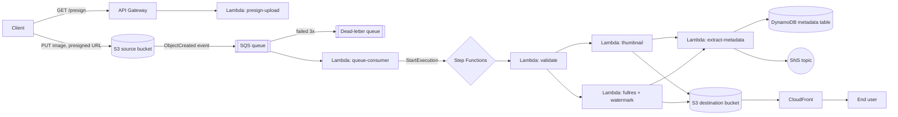

# Serverless Image Processing Pipeline (S3 + SQS + Lambda + Step Functions)

Uploads to an S3 source bucket publish events to SQS. A Lambda consumer starts a
Step Functions execution that validates the image, generates a thumbnail and a
watermarked full-resolution copy in parallel, extracts metadata into DynamoDB,
and sends an SNS notification. Processed images are served through CloudFront.

## Architecture



Save this diagram (or a Lucidchart/draw.io version of it) as your submitted
Solution Architecture Diagram.

## AWS services used

| Service | Role |
|---|---|
| S3 (source + destination) | Upload landing zone; processed-asset store |
| SQS + DLQ | Decouples S3 events from processing; retries then dead-letters |
| Lambda | Presign, queue consumer, validate, resize, watermark, metadata |
| Step Functions | Orchestrates validate → resize/watermark (parallel) → metadata → notify |
| API Gateway (HTTP API) | Pre-signed URL endpoint for uploads |
| DynamoDB | Image metadata store |
| CloudFront | Serves processed images globally, low latency |
| SNS | Success/failure notifications |

## Prerequisites

1. An AWS account with permissions to create the resources above.
2. [AWS CLI](https://docs.aws.amazon.com/cli/latest/userguide/getting-started-install.html) installed and configured: `aws configure`
3. [AWS SAM CLI](https://docs.aws.amazon.com/serverless-application-model/latest/developerguide/install-sam-cli.html) installed (`sam --version` should work).
4. Docker installed and running (SAM uses it to build the Pillow layer with the correct Lambda binaries — this step fails without it).
5. Python 3.12 available locally (SAM will still use Docker for the actual build).

## Step 1 — Build

From the project root (the folder containing `template.yaml`):

```bash
sam build --use-container
```

`--use-container` is required: Pillow contains compiled C extensions, and
building it outside a Lambda-like container produces a layer that fails at
runtime with `Unable to import module: libjpeg not found`-style errors.

## Step 2 — Deploy (guided, first time only)

```bash
sam deploy --guided
```

Answer the prompts:
- **Stack Name**: e.g. `image-pipeline`
- **AWS Region**: e.g. `us-east-1`
- **Parameter ProjectName**: press Enter to accept the default (`image-pipeline`) or set your own — it must produce globally-unique S3 bucket names, since the template appends your account ID and region already
- **Confirm changes before deploy**: `Y`
- **Allow SAM CLI IAM role creation**: `Y`
- **Save arguments to samconfig.toml**: `Y`

This writes a `samconfig.toml` so future deploys are just `sam deploy`.

Deployment takes 3–6 minutes (CloudFront distributions are the slowest part).
When it finishes, note the **Outputs** section — you'll need `ApiEndpoint`,
`SourceBucketName`, `CloudFrontDomainName`, and `StateMachineArn`.

## Step 3 — Subscribe to notifications (optional but recommended)

```bash
aws sns subscribe \
  --topic-arn <NotificationTopicArn from outputs> \
  --protocol email \
  --notification-endpoint you@example.com
```

Confirm the subscription from the email AWS sends you.

## Step 4 — Test end to end

**Get a presigned upload URL:**

```bash
curl "<ApiEndpoint>?filename=test.jpg&contentType=image/jpeg"
```

This returns JSON like `{"uploadUrl": "...", "bucket": "...", "key": "uploads/<uuid>.jpg"}`.

**Upload an image using that URL:**

```bash
curl -X PUT -H "Content-Type: image/jpeg" --upload-file ./test.jpg "<uploadUrl>"
```

**Watch the pipeline run.** Within a few seconds a Step Functions execution
should start. Check it either in the AWS Console (Step Functions → your state
machine → Executions), or via CLI:

```bash
aws stepfunctions list-executions --state-machine-arn <StateMachineArn> --max-results 5
```

Pick the newest execution ARN and inspect it:

```bash
aws stepfunctions describe-execution --execution-arn <executionArn>
```

`status` should reach `SUCCEEDED`. If it fails, `describe-execution` shows
which state failed and why (also check CloudWatch Logs for the relevant
Lambda function, named e.g. `/aws/lambda/image-pipeline-validate`).

**Verify the outputs:**

```bash
# Thumbnail + watermarked full-res copy landed in the destination bucket
aws s3 ls s3://<DestinationBucketName>/thumbnails/ --recursive
aws s3 ls s3://<DestinationBucketName>/fullres/ --recursive

# Metadata row was written
aws dynamodb scan --table-name <MetadataTableName>

# Image is servable via CloudFront (path mirrors the destination bucket key)
curl -I "https://<CloudFrontDomainName>/thumbnails/uploads/<uuid>.jpg"
```

A `200 OK` from the CloudFront `curl` confirms the whole chain — upload,
processing, storage, and CDN delivery — is working.

**Test the failure path** (confirms SQS/DLQ + Step Functions error handling):

```bash
curl "<ApiEndpoint>?filename=test.txt&contentType=image/jpeg"
# upload any small text file with that URL, then check the execution:
# it should reach FAILED and you should get an SNS "processing FAILED" email
```

## Step 5 — Everyday deploys

After the first guided deploy, ship changes with:

```bash
sam build --use-container
sam deploy
```

## Troubleshooting

- **`libjpeg`/Pillow import errors in Lambda logs** → you built without
  `--use-container`; rebuild with it.
- **Step Functions never starts** → check CloudWatch Logs for
  `image-pipeline-queue-consumer`; also confirm messages are landing in the
  SQS queue (`aws sqs get-queue-attributes --queue-url <url> --attribute-names ApproximateNumberOfMessages`).
- **`AccessDenied` on S3 → SQS notification setup** → this is almost always a
  stack that partially deployed before the queue policy existed; delete and
  redeploy the stack, or ensure `SourceQueuePolicy` exists before the bucket's
  `NotificationConfiguration` is applied (the template already orders this
  via `DependsOn`).
- **CloudFront returns `403`** → the OAC bucket policy references the
  distribution by ID; if you renamed resources, redeploy so the policy
  condition picks up the new distribution ID.

## Cleanup (avoid ongoing charges)

S3 buckets must be emptied before the stack can delete them:

```bash
aws s3 rm s3://<SourceBucketName> --recursive
aws s3 rm s3://<DestinationBucketName> --recursive
sam delete
```

## Repo layout

```
.
├── template.yaml              # SAM/CloudFormation infrastructure
├── statemachine/
│   └── workflow.asl.json      # Step Functions definition
├── src/
│   ├── presign_upload/        # API Gateway Lambda: presigned PUT URL
│   ├── queue_consumer/        # SQS Lambda: starts Step Functions executions
│   ├── validate_image/        # Step Functions task: type/size validation
│   ├── generate_thumbnail/    # Step Functions task: 200x200 thumbnail
│   ├── process_fullres/       # Step Functions task: watermarked full-res copy
│   ├── extract_metadata/      # Step Functions task: writes DynamoDB row
│   └── layer/requirements.txt # Pillow layer dependency
└── events/sample-sfn-input.json
```
